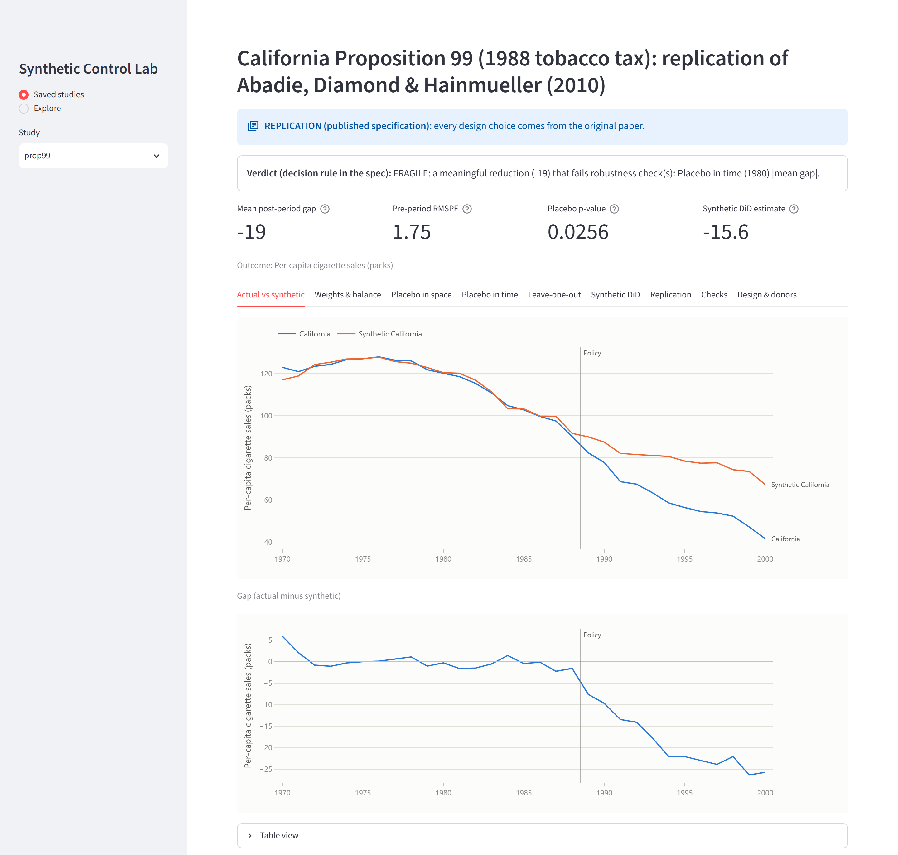
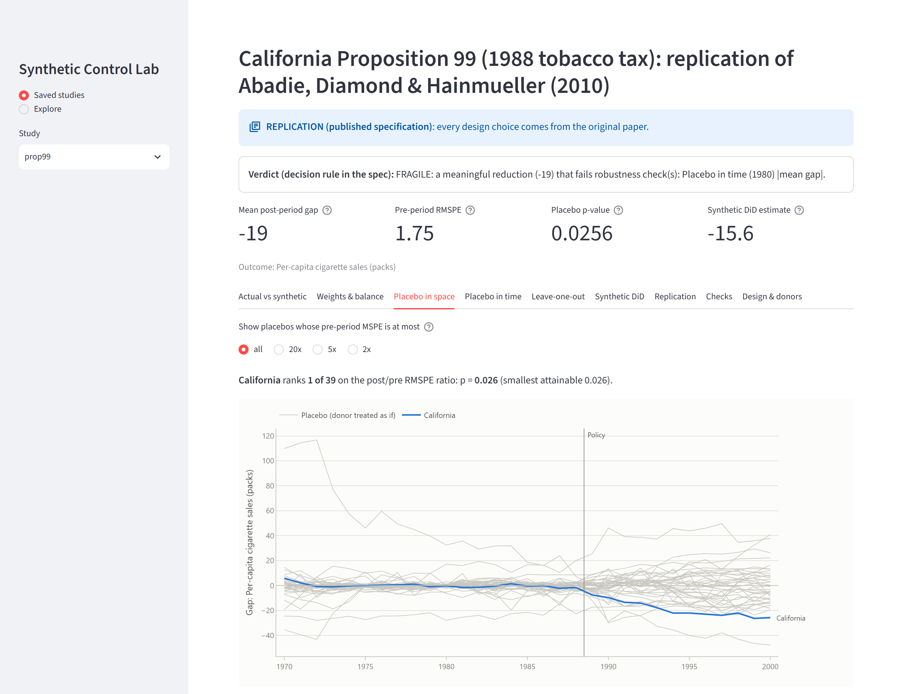
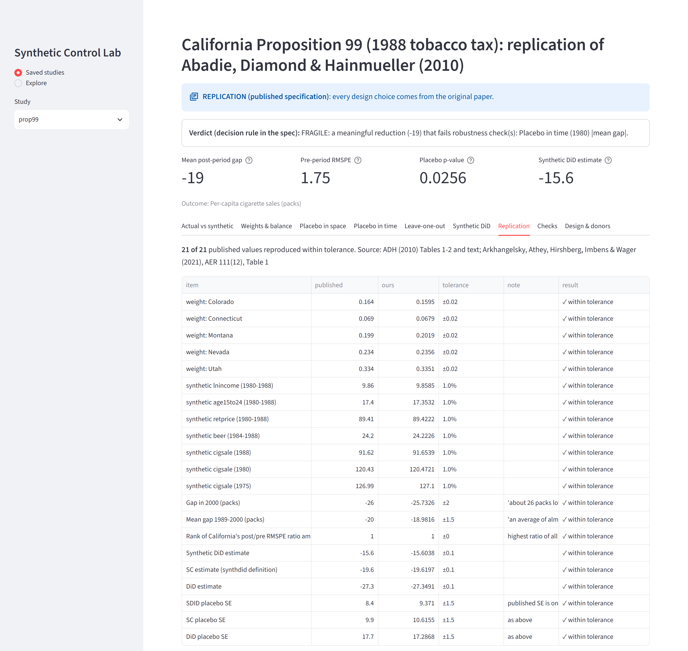
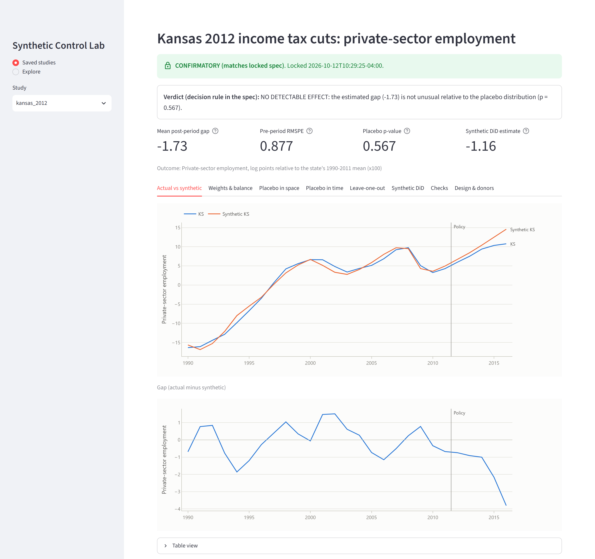
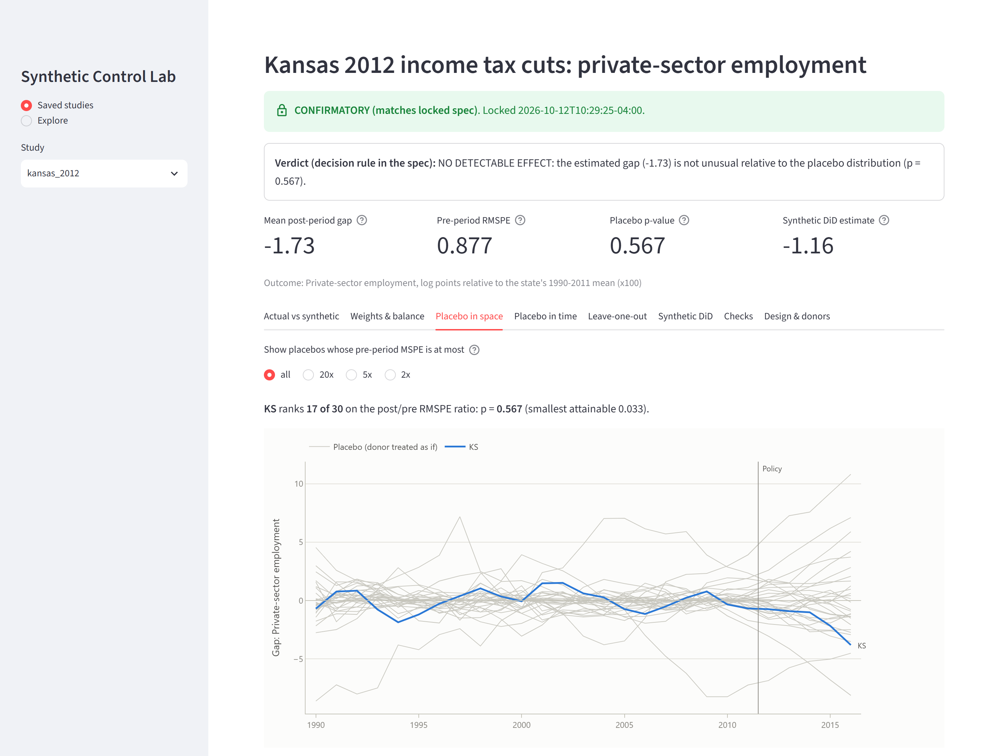
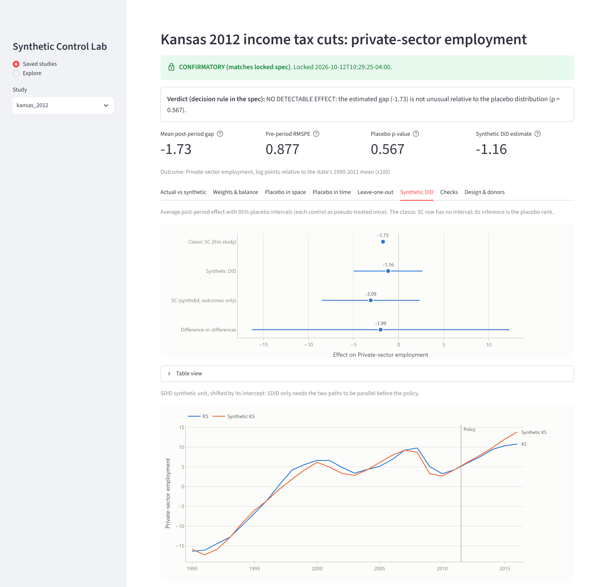
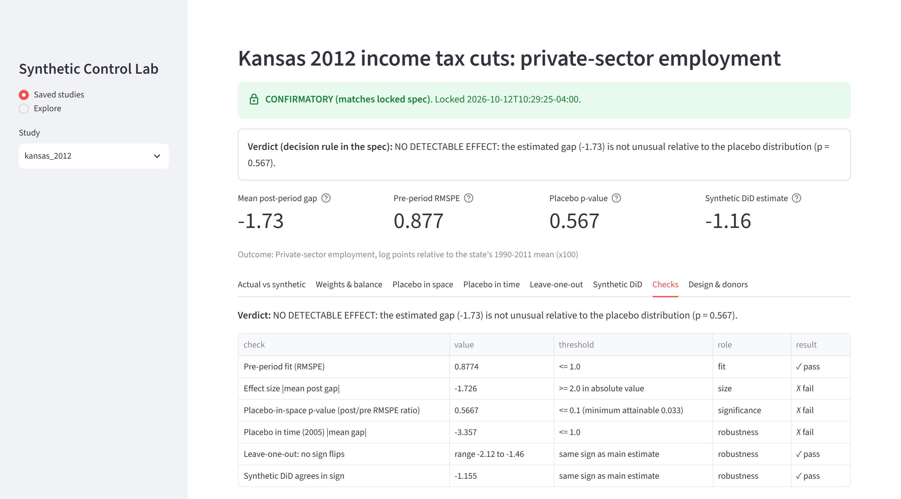
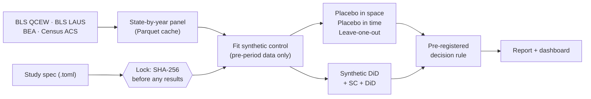

<h1 align="center">Synthetic Control Lab</h1>

<p align="center">
  <b>Did a state policy actually change anything?</b><br>
  Build a "synthetic twin" of the state from other states that tracked it before the policy,
  then test whether the gap that opens up afterwards is real or just noise.
</p>

<p align="center">
  <a href="https://github.com/rednaksiii/synthetic-control-lab/actions/workflows/tests.yml"></a>
  
  
  
</p>

<picture>
  <source media="(prefers-color-scheme: dark)" srcset="docs/screenshots/01_prop99_actual_vs_synthetic_dark.png">
  
</picture>

## Why this exists

A state raises a tax and three years later something has changed. Was it the policy? You can't
tell without knowing what would have happened *without* it: the counterfactual. The
**synthetic control method** estimates that counterfactual from real data. It finds a weighted
blend of untreated states (say 33% Utah + 24% Nevada + 20% Montana + …) that matched the treated
state closely *before* the policy, and lets that blend carry on as "the state without the policy".

This project implements the method from scratch, validates it against published results, and
then uses it on a contested question: the 2012 Kansas income tax cuts. It does so under a
**pre-registered, hash-locked analysis plan**, so the setup can't be quietly tuned until it
gives the answer someone wanted.

## Highlights

- **Validated against the literature.** Reproduces Abadie, Diamond & Hainmueller (2010) on
  California's Proposition 99, and the synthetic DiD estimates of Arkhangelsky et al. (2021):
  **21 of 21 published values matched.**
- **Pre-registration built in.** Each study's spec is locked by SHA-256 before any results exist.
  A changed spec is automatically labelled *exploratory*, and the verdict comes mechanically from
  thresholds fixed in advance.
- **A complete inference toolkit.** Placebo in space (post/pre RMSPE ranks with MSPE filters),
  placebo in time, leave-one-out, and synthetic difference-in-differences with placebo standard
  errors.
- **A real data pipeline.** Fetchers for BLS QCEW, BLS LAUS, BEA and the Census ACS build a cached
  Parquet panel of 51 states × 1990–2025, resuming automatically after interruptions.
- **An interactive dashboard.** Streamlit + Plotly, with an Explore mode for ad-hoc analyses
  (clearly labelled as not pre-registered) and shareable deep links.
- **Tested.** 52 tests covering solver optimality (KKT conditions), recovery of planted effects,
  a "no peeking" test, the data parsers, the lock workflow, and the full replication.

## Results at a glance

### 1. Validation: California Proposition 99 (1988 tobacco tax)

| | Published | This code |
|---|---|---|
| Donor weights: UT / NV / MT / CO / CT | .334 / .234 / .199 / .164 / .069 | .335 / .236 / .202 / .160 / .068 |
| Gap in cigarette sales by 2000 | "about −26 packs" | −25.7 packs |
| Average gap, 1989–2000 | "almost −20 packs" | −19.0 packs |
| California's rank among 39 placebo states | 1st (p = 0.026) | 1st (p = 0.026) |
| Synthetic DiD / SC / DiD | −15.6 / −19.6 / −27.3 | −15.60 / −19.62 / −27.35 |

**A finding beyond the paper.** Pretending the policy started in 1980 and fitting only on 1970–79,
California already falls about 9.5 packs below its twin before Prop 99 existed. So California was
declining faster than its donors even before the tax. The pre-registered rule therefore rates the
result **FRAGILE**: a real but partly pre-existing decline. The threshold was not relaxed after
this was seen.

### 2. New analysis: Kansas 2012 income tax cuts (pre-registered)

The 2012 law cut the top rate from 6.45% to 4.9% and exempted pass-through business income. The
donor pool excluded neighbouring states, energy states, and every state with its own major tax
change in 2010–2016 (each one verified against sources), leaving 29 donors.

| Outcome | Estimate (2012–2016) | Placebo rank | Verdict |
|---|---|---|---|
| **Private-sector employment** (primary) | −1.7% on average, −3.8% by 2016 | 17 of 30 (p = 0.57) | **No detectable effect** |
| Real GDP per capita | −1.1% | 29 of 30 (p = 0.97) | No detectable effect |
| Private establishments | n/a | n/a | Inconclusive (pre-period fit failed) |

In plain words, there is no sign of the promised job boost. Kansas did grow a little more slowly
than its twin, but gaps that size are ordinary among the placebo states, and Kansas shows a similar
gap even in a fake 2005 "policy" test. The full plan, sources and caveats are in
[PREREGISTRATION.md](PREREGISTRATION.md).

## Screenshots

<table>
  <tr>
    <td width="50%"><br><sub><b>Placebo in space.</b> California's gap (blue) against every donor state given a fake policy (gray).</sub></td>
    <td width="50%"><br><sub><b>Replication check.</b> Every published value from the two papers, with tolerances.</sub></td>
  </tr>
  <tr>
    <td width="50%"><br><sub><b>Kansas vs synthetic Kansas.</b> A confirmatory run that matches the locked spec.</sub></td>
    <td width="50%"><br><sub><b>Kansas sits in the middle of the placebo pack</b>, so the gap is not unusual.</sub></td>
  </tr>
  <tr>
    <td width="50%"><br><sub><b>Robustness.</b> Classic SC, synthetic DiD, SC and DiD with 95% placebo intervals.</sub></td>
    <td width="50%"><br><sub><b>The decision rule.</b> Every pre-registered check and how the verdict follows from it.</sub></td>
  </tr>
</table>

Dark-theme versions of every view are in [docs/screenshots](docs/screenshots).

## How it works



1. **Weights.** Donor weights *W* (non-negative, summing to 1) make the synthetic state match the
   treated state's pre-policy predictors. Predictor importances *V* are chosen so the synthetic
   state tracks the pre-policy outcome path (the nested ADH optimisation).
2. **Gap.** After the policy, *actual minus synthetic* is the estimated effect.
3. **Placebos.** Rerun the method for every donor as if it had been treated, and for fake earlier
   dates. If the real gap doesn't stand out, it isn't evidence.
4. **Verdict.** Thresholds written before the run turn the checks into one of: MEANINGFUL EFFECT,
   FRAGILE, UNUSUAL BUT SMALL, NO DETECTABLE EFFECT, or INCONCLUSIVE.

## Quick start

```bash
git clone https://github.com/rednaksiii/synthetic-control-lab.git
cd synthetic-control-lab
python -m venv .venv && source .venv/bin/activate   # Windows: .venv\Scripts\activate
pip install -e ".[dashboard,dev]"

synthpolicy run specs/prop99.toml --jobs 4   # replicate Prop 99 (downloads a pinned dataset)
synthpolicy dashboard                        # open the dashboard
pytest -q                                    # run the 52 tests
```

The repository ships the saved results, so the dashboard works immediately. To rebuild the state
panel from the government sources:

```bash
synthpolicy fetch --start 1990 --industries 10,722
```

| Source | Contents | Access |
|---|---|---|
| BLS QCEW | Employment, establishments and wages by industry | Keyless (API from 2014, bulk files before) |
| BLS LAUS | Labour force and unemployment | Keyless with daily limits; `BLS_API_KEY` raises them |
| BEA | GDP, mining GDP, personal income, population | Keyless bulk files |
| Census ACS | Rents, home values, income | Requires a free `CENSUS_API_KEY` |

## Pre-registration workflow

```bash
synthpolicy lock specs/my_study.toml --note "why and when"   # records the spec's SHA-256
synthpolicy status specs/my_study.toml                       # locked / modified / unlocked
synthpolicy run specs/my_study.toml                          # CONFIRMATORY only if it still matches
```

Each spec (TOML) fixes the treated unit, first treated year, outcome and transform, donor-pool
rules (explicit exclusions, bordering states, data-driven rules such as "mining > 8% of GDP"), the
predictors, the inference plan, and the decision thresholds.
[PREREGISTRATION.md](PREREGISTRATION.md) holds the human-readable reasoning and a deviation log.

## Project structure

```
synthpolicy/
  data/          fetchers (QCEW, LAUS, BEA, ACS, Prop 99) and the state panel builder
  model/         synthetic control (nested V/W) and an exact simplex least-squares solver
  inference/     placebo in space, placebo in time, leave-one-out
  robustness/    synthetic DiD: a port of the reference synthdid R algorithm
  spec.py        TOML specs and the SHA-256 pre-registration lock
  pipeline.py    runs a whole study and applies the decision rule
dashboard/       Streamlit app and Plotly charts
specs/           prop99.toml (replication), kansas_2012*.toml (+ .lock.json)
results/         saved study outputs (Parquet, JSON, Markdown report)
scripts/         capture_screenshots.py (headless Chrome via Playwright)
tests/           52 tests
```

## Engineering notes

- **No peeking.** Weights use pre-policy data only. A test scrambles post-policy outcomes and checks
  that the weights don't move. Placebo-in-time fits recompute outcome transforms so their baselines
  stop before the fake date.
- **Exact inner solver.** The simplex-constrained least-squares problem is solved exactly: an NNLS
  warm start, then a primal active-set method, verified against the KKT conditions.
- **Non-unique weights.** When the treated state lies inside the donors' convex hull, many weightings
  fit equally well. The fit detects and reports this, and an optional tie-break picks the weighting
  that best tracks the pre-period outcome path.
- **SDID fidelity.** Frank-Wolfe with sparsification, mirroring the reference implementation. Point
  estimates match the paper to two decimals; placebo SEs are computed exhaustively (each control
  once), which is deterministic.
- **Resilient fetching.** Per-year and per-request caching, retries on broken downloads, a pinned
  and checksummed replication dataset, and API-quota-aware batching for BLS.

## Limitations

- Synthetic control assumes no spillovers into donor states and no concurrent shocks specific to
  the treated state. Both are argued in the spec, not proven.
- With one treated unit, the smallest attainable placebo p-value is 1/(number of donors + 1).
- The Kansas window ends in 2016 because the cuts were repealed in 2017, so long-run effects
  cannot be measured.

## References

- Abadie, A., Diamond, A., & Hainmueller, J. (2010). Synthetic Control Methods for Comparative Case
  Studies: Estimating the Effect of California's Tobacco Control Program. *JASA*, 105(490).
- Abadie, A., Diamond, A., & Hainmueller, J. (2015). Comparative Politics and the Synthetic Control
  Method. *American Journal of Political Science*, 59(2).
- Arkhangelsky, D., Athey, S., Hirshberg, D., Imbens, G., & Wager, S. (2021). Synthetic
  Difference-in-Differences. *American Economic Review*, 111(12).
- Abadie, A. (2021). Using Synthetic Controls: Feasibility, Data Requirements, and Methodological
  Aspects. *Journal of Economic Literature*, 59(2).

## License

[MIT](LICENSE)
